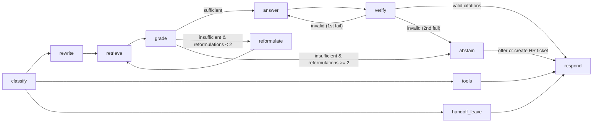

# ADR 010: Stage 7 Policy Brain & Helpdesk Architecture

Status: Decided (Builds on ADR 002, ADR 007, ADR 008, and ADR 009)
Date: 2026-11-23

## Context
Stage 7 delivers **Policy Brain & Helpdesk** on top of Stage 5's bilingual hybrid retrieval foundation (ADR 008) and Stage 6's deterministic leave and attendance core (ADR 009). Employees and managers need a trustworthy, bilingual (English, Urdu script, and Roman Urdu) assistant that answers corporate policy and Helpdesk KB questions with verifiable clause citations, reads live personal HR balances safely, hands off leave-application intent to deterministic flows, and seamlessly routes unresolved or operational requests to an auditable HR/IT/Facilities Helpdesk ticketing system with Temporal-enforced SLAs.

Consistent with **Rule 3 (LLM proposes, code decides)** and **Rule 6 (Untrusted data defense)**, the LLM may propose answers, intent classifications, and draft ticket payloads, but access control, session binding, citation verification, SLA deadlines, assignment routing, and leave mutations remain strictly deterministic in Python and PostgreSQL under Forced RLS.

---

## Decision

### 1. LangGraph Self-Correcting RAG Pipeline
Policy Brain orchestration executes as a bounded, deterministic state machine in LangGraph:

- **`classify`**: Determines query intent (`policy_qa`, `personal_data_tool`, `leave_handoff`, `helpdesk_qa`, or `ask_hr`) and detects input language (`en | ur | roman_ur | mixed`).
- **`rewrite`**: Resolves pronouns and follow-up references using recent session turns before retrieval.
- **`retrieve`**: Calls Stage 5's hybrid bilingual search (`RRF` over `pgvector` HNSW, `'simple'` FTS, and `pg_trgm`) scoped strictly by `tenant_id`, `lifecycle_status = 'active'`, `ingestion_status = 'indexed'`, `doc_scope`, and role-based `visibility` (`all | managers | hr_only`).
- **`grade` & `reformulate` (`<= 2` retries)**: Grades whether retrieved chunks contain sufficient evidence. If insufficient, reformulates the query at most twice (`reformulate <= 2`) before transitioning cleanly to `abstain`.
- **`tools`**: Executes read-only personal HR lookups (see Section 2) and combines returned facts deterministically.
- **`handoff_leave`**: Extracts structured draft leave parameters into `handoff_payload` for the deterministic Stage 6 Leave intake UI/API—never directly reserving or approving leave in the LLM turn.
- **`answer` -> `verify` -> `respond`**: Generates grounded bilingual answers wrapped against prompt injection, validates citations in Python (Section 3), and persists the turn to `chat_messages`.

---

### 2. Server-Session-Bound Tool Security
Policy Brain exposes **exactly 6 server-session-bound tools**:
1. `search_policy`
2. `get_my_leave_balance`
3. `get_my_leave_requests`
4. `get_my_manager`
5. `create_ticket`
6. `start_leave_request`

**Binding Security Invariants**:
- All 6 tools derive `tenant_id`, `user_id`, `employee_id`, `role`, and `is_hr_head` **strictly from the server-verified `AuthenticatedUserContext`**—never from LLM-supplied arguments, query strings, or retrieved document text.
- Any LLM-emitted `tenant_id`, `user_id`, or `employee_id` parameter is rejected or ignored by the tool wrapper.
- Every database read/write inside tool execution runs inside a transaction with `SET LOCAL app.tenant_id` enforced by Forced RLS (ADR 002).
- All user prompts and retrieved document snippets passed into model context are encapsulated via `wrap_untrusted_text()` (`app/core/untrusted.py`) to neutralize prompt injection.

---

### 3. Code-Level Citation Verification (LLM Proposes, Code Decides)
- Every non-abstained policy or Helpdesk KB answer **MUST** include at least one `CitationItem(chunk_id, document_id, title, version, section, page, snippet)`.
- A deterministic Python verifier inspects every returned `CitationItem` against the **current turn's RLS- and visibility-filtered retrieval candidate set**:
  - `chunk_id` and `document_id` must match an exact retrieved chunk from the active turn.
  - `version`, `title`, and `section` must match the authoritative DB metadata.
  - Answers with zero verified citations or fabricated/cross-visibility chunk IDs fail verification.
- **Bounded Recovery**:
  - **1st verification failure**: Regenerate once (`answer`) with strict grounding constraints referencing only verified chunk IDs.
  - **2nd verification failure**: Deterministically override output to `abstained = true`, clear unverified claims, and offer or create an HR escalation ticket (`source = 'chat_abstain'`).

---

### 4. Bilingual Urdu / English / Roman Urdu Session Memory
- `chat_sessions.language` and `chat_messages.language` explicitly track `en`, `ur` (Arabic/Nastaliq script), `roman_ur` (Roman Urdu), and `mixed`.
- Sliding-window conversation history is persisted in PostgreSQL under Forced RLS (`chat_sessions` + `chat_messages`) so follow-up questions inherit context, topic tags (`topic_tag`), and language preference while keeping per-turn telemetry (`latency_ms`, `model_tier`, `token_usage`, `cost_usd`).
- Answer generation responds in the active language detected for the turn (`en`, `ur`, `roman_ur`, or `mixed`).

---

### 5. Helpdesk Read-Only Agent Boundary & Corpus Separation
- `policy_documents` retains Stage 5's role-visibility column (`visibility IN ('all', 'managers', 'hr_only')`) untouched and adds `doc_scope IN ('hr_policy', 'helpdesk_kb')` (backfilling `doc_type = 'helpdesk_knowledge'` rows to `'helpdesk_kb'`).
- The Helpdesk Agent reads solely from `doc_scope = 'helpdesk_kb'` (subject to the caller's `visibility` tier) and may draft/create Helpdesk tickets (`source = 'helpdesk_agent'`).
- **Strictly Read-Only Action Boundary**: The Helpdesk Agent **NEVER** performs privileged administrative actions—it cannot reset passwords, provision IT accounts, alter RBAC roles, modify payroll/attendance, or approve leaves or Stage 2 gates. It resolves via KB guidance or opens a routed ticket for human staff.

---

### 6. Category Assignment Rules, Internal Notes Isolation & SLA Lifecycle
- **Category Assignment Rules (`public.ticket_assignment_rules`)**:
  - Keyed uniquely per `(tenant_id, category)` across `hr_policy | leave_attendance | payroll | it_access | facilities | general`.
  - Resolves `default_assignee_user_id` or fallback `default_assignee_role` (`hr_head | owner | manager`), `sla_hours` (default `24`), `reminder_before_hours` (default `4`, constrained `< sla_hours`), and `reopen_window_days` (default `7`).
- **Internal Notes Isolation (`ticket_messages.is_internal`)**:
  - Ticket replies with `is_internal = true` are strictly restricted to authorized HR/Owner/assigned handlers.
  - Requester-facing endpoints strip `is_internal = true` rows, and `public.pub_ticket_summary` excludes internal note bodies and internal counts entirely.
- **Temporal `TicketSLAWorkflow`**:
  - Dispatched post-commit via Outbox / Temporal upon ticket creation with deterministic `sla_reminder_at` and `sla_due_at`.
  - Sleeps until `sla_reminder_at` to issue a pre-breach reminder notification and stamp `sla_reminder_sent_at` (idempotent if already resolved/closed).
  - Sleeps until `sla_due_at` to escalate to `hr_head`/`owner` and stamp `sla_escalated_at` if still unresolved.
  - All user-facing SLA timestamps normalize to `Asia/Karachi` (`PKT, UTC+05:00` via `app.core.timezones`).
- **Close Rating & Reopen Window**:
  - Resolving a ticket sets `resolved_at` and computes `reopen_until = resolved_at + reopen_window_days`.
  - Requesters can reopen a resolved ticket prior to `reopen_until` and submit post-closure feedback (`satisfaction_rating` `1..5` + optional `satisfaction_comment`).
- **Secure View (`public.pub_ticket_summary`)**:
  - Defined `WITH (security_invoker = true, security_barrier = true)`, owned by `agentic_hr_migrator`, and granted `SELECT` only to `agentic_hr_app`.
  - Exposes tenant-scoped ticket metadata, requester/assignee display names (excluding emails/PII), `is_sla_breached`, and `COALESCE(..., 0)::int AS public_message_count` (`is_internal = false` only), while strictly omitting `description` and all internal notes.

---

### 7. Model Routing & Privacy Governance (ADR 007)
- `ModelRoute.CHEAP` handles intent classification, query rewriting/reformulation, and evidence grading.
- `ModelRoute.STRONG` handles bilingual Policy Brain / Helpdesk synthesis and grounded regeneration.
- `ModelRoute.PRIVATE` remains fail-closed for any real (non-synthetic) sensitive employee PII.
- All pipelines support deterministic offline execution under `USE_FAKE_INTEGRATIONS=true` for CI and test suites.

---

## Consequences
- Zero unverified policy hallucinations reach employees: ungrounded claims regenerate once and deterministically abstain into an auditable HR ticket.
- Strict least-privilege isolation across all 6 new tables (`chat_sessions`, `chat_messages`, `answer_feedback`, `tickets`, `ticket_messages`, `ticket_assignment_rules`), server-bound tools, and `pub_ticket_summary`.
- Backward-compatible evolution of `policy_documents` preserving Stage 5 `visibility` semantics while cleanly separating `hr_policy` and `helpdesk_kb` scopes.
