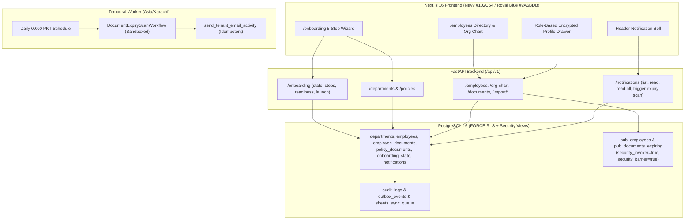

# Stage 4: Onboarding Wizard, Employees & Encrypted Record Keeper (Milestone B — Phase 0) — Verification & Exit Gate Report

**Date of Verification:** 2026-11-21  
**Platform Version:** Agentic HR Core — Stage 4 (Milestone B: Phase 0)  
**Target Tag:** `v0.4-stage4-hardened`  
**Execution Environment:** Windows / Docker PostgreSQL 16 + pgvector, Redis, Temporal  
**Active Integration Mode:** `USE_FAKE_INTEGRATIONS=true` (with full Google Drive / Gmail parity)  
**Audit Status:** **STAGE 4 (MILESTONE B) EXIT GATE READY**

---

## 1. Executive Summary & Architectural Guarantees

Stage 4 (**Milestone B — Phase 0: Onboarding Wizard, Employees & Encrypted Record Keeper**) transforms Agentic HR Core from platform infrastructure and connectors into an operational multi-tenant HR system of record backed by PostgreSQL 16 Row-Level Security (`FORCE ROW LEVEL SECURITY`), `security_invoker`/`security_barrier` views, per-tenant AAD AES-256-GCM PII encryption, Temporal daily scheduling, and a full Next.js 16 enterprise UI.

### Core Guarantees Verified Across Prompts 1–8:
1. **Multi-Tenant Isolation at DB & View Layer (ADR 002)**:
   - Migrations `0014` & `0015` add 6 forced-RLS tables (`departments`, `employees`, `employee_documents`, `policy_documents`, `onboarding_state`, `notifications`), 2 `security_invoker=true, security_barrier=true` views (`pub_employees`, `pub_documents_expiring`), and `public.document_scan_tenant_ids` (`SECURITY DEFINER` tenant discovery for background Temporal scans).
   - Bogus tenant UUID `00000000-0000-0000-0000-000000000000` under `agentic_hr_app` returns **0 rows** on every table and view.
2. **AES-256-GCM 4-Field AAD PII Encryption**:
   - Employee Pakistani CNICs and IBAN/bank account numbers are encrypted at rest via `EncryptionContext(tenant_id, "employee", record_id, field_name)`.
   - `GET /api/v1/employees` queries strictly `public.pub_employees` and never exposes CNIC or bank account columns.
   - `GET /api/v1/employees/{id}` decrypts PII **only** for `owner`, `is_hr_head`, `is_payroll_admin`, or `self` (`employee.user_id == actor.user_id`), emitting `employee.sensitive_viewed` audit logs containing **zero** raw PII.
3. **Two-Phase Excel Bulk Importer (`openpyxl==3.1.5`)**:
   - Strict multi-pass validation (header check, Pakistani CNIC/IBAN formatting, department lookup, internal `manager_email` resolution & cycle prevention, formula-injection neutralization on downloadable `.xlsx` error reports).
   - Redis `NX` commit lock prevents double-commit races and enqueues PostgreSQL-authoritative `sheets_sync_queue` events.
4. **Resumable 5-Step Onboarding Wizard & PKT Launch**:
   - Tracks Steps 1–5 (`Connect Tools`, `Upload Policies`, `Company Structure`, `Add Employees`, `Test & Launch`) with Stage 6 `structure_config` placeholders (`weekends=["Saturday", "Sunday"]`, `leave_rules`, `holidays`).
   - Deterministic readiness checklist (`GET /api/v1/onboarding/readiness`) gates `POST /api/v1/onboarding/launch`, which records `launched_at` in `Asia/Karachi` (`+05:00`) and dispatches idempotent employee invitations before external connector calls.
5. **Temporal Daily 30/7/1-Day Document Expiry Schedule & Notification Engine**:
   - Sandboxed `DocumentExpiryScanWorkflow` + daily `09:00 Asia/Karachi` Temporal Schedule scan `public.pub_documents_expiring` for `active`/`on_leave` employees at 30 (`info`), 7 (`warning`), and 1 (`critical`) days.
   - Deterministic recipient-suffixed `dedupe_key` and `Idempotency-Key` guarantee zero duplicate in-app notifications or emails on repeated runs.
6. **Next.js 16 Enterprise UI & OpenAPI Contract Sync**:
   - Resumable `/onboarding` 5-step wizard, live `/employees` Directory Table + Role-Based Encrypted Profile Drawer + Interactive Org Chart (`/directory` permanently redirects to `/employees`), and Global Header Notification Bell powered by OpenAPI-generated TypeScript types in `packages/contracts`.

---

## 2. Architecture Overview

---

## 3. Migrations & Database Inventory (`0014` & `0015`)

| Migration | File | Objects Created | Security / RLS Guarantee |
| :--- | :--- | :--- | :--- |
| **0014** | `0014_stage4_employees_and_onboarding.py` | `departments`, `employees`, `employee_documents`, `policy_documents`, `onboarding_state`, `notifications`, `pub_employees`, `pub_documents_expiring` | `FORCE ROW LEVEL SECURITY` on all 6 tables; `security_invoker=true, security_barrier=true` on both views; `pub_employees` omits PII columns |
| **0015** | `0015_document_scan_tenant_discovery.py` | `public.document_scan_tenant_ids()` | `SECURITY DEFINER` returning active, non-suspended tenant UUIDs for background Temporal scan without bypassing per-tenant RLS reads |

---

## 4. Stage 4 API & RBAC Matrix

| Route Group | Key Endpoints | Auth / Role Enforcement |
| :--- | :--- | :--- |
| **Onboarding** | `GET /state`, `PUT /steps/{1..5}`, `GET /readiness`, `POST /launch` | `owner`/`manager`/`hr_head` for steps; `owner`/`hr_head` for `/launch` |
| **Departments & Policies** | `GET/POST/PATCH/DELETE /departments`, `GET/POST/DELETE /policies` | Tenant-scoped RBAC; `409 DEPARTMENT_NOT_EMPTY` guard |
| **Excel Import** | `GET /import/template`, `POST /import/validate`, `GET /import/{id}/error-report`, `POST /import/{id}/commit` | `owner`/`manager`/`hr_head`; Redis NX commit lock; masked preview PII |
| **Employees & Vault** | `GET/POST/PATCH /employees`, `GET /org-chart`, `GET/POST/DELETE /employees/{id}/documents`, `GET .../download` | PII decrypted only for Owner/HR Head/Payroll Admin/Self; `audit_logs` on view |
| **Notifications** | `GET /notifications`, `PATCH /{id}/read`, `POST /read-all`, `POST /trigger-expiry-scan` | Owner/HR Head see tenant alerts; others see own; scan restricted to Owner/HR Head |

---

## 5. Verification Suites Inventory

- **Backend Stage 4 Suites**:
  - `apps/api/tests/test_stage4_data_and_rls.py` (Prompt 1: migrations, PII encryption, RLS, Acme 40-employee seed)
  - `apps/api/tests/test_stage4_onboarding_api.py` (Prompt 2: steps, departments, policies stub, readiness, idempotent launch)
  - `apps/api/tests/test_stage4_excel_import.py` (Prompt 3: template, strict validation, formula-safe error report, two-phase commit)
  - `apps/api/tests/test_stage4_employees_and_docs.py` (Prompt 4: directory view, RBAC PII & audit logs, cycle-safe org chart, Drive/local document vault)
  - `apps/api/tests/test_stage4_expiry_and_notifications.py` (Prompt 5: PKT 30/7/1-day scan, dedupe, sandboxed Temporal workflow, notifications RBAC)
  - `apps/api/tests/test_stage4_exit_verification.py` (Prompt 8: 10-employee Milestone B exit walkthrough, 10-route cross-tenant API isolation matrix, bogus-tenant `agentic_hr_app` RLS audit)
- **Frontend Stage 4 Suites**:
  - `apps/web/src/test/onboarding-wizard.test.tsx` (Prompt 6: 5-step wizard, Step 1–5 workflows, standby/HTTP errors)
  - `apps/web/src/test/employees-and-notifications.test.tsx` (Prompt 7: directory, encrypted profile drawer, org chart, notification bell)
  - `apps/web/e2e/smoke.spec.ts` & `apps/web/e2e/stage4.spec.ts` (Playwright E2E navigation, tabs, bell, console/hydration checks)
