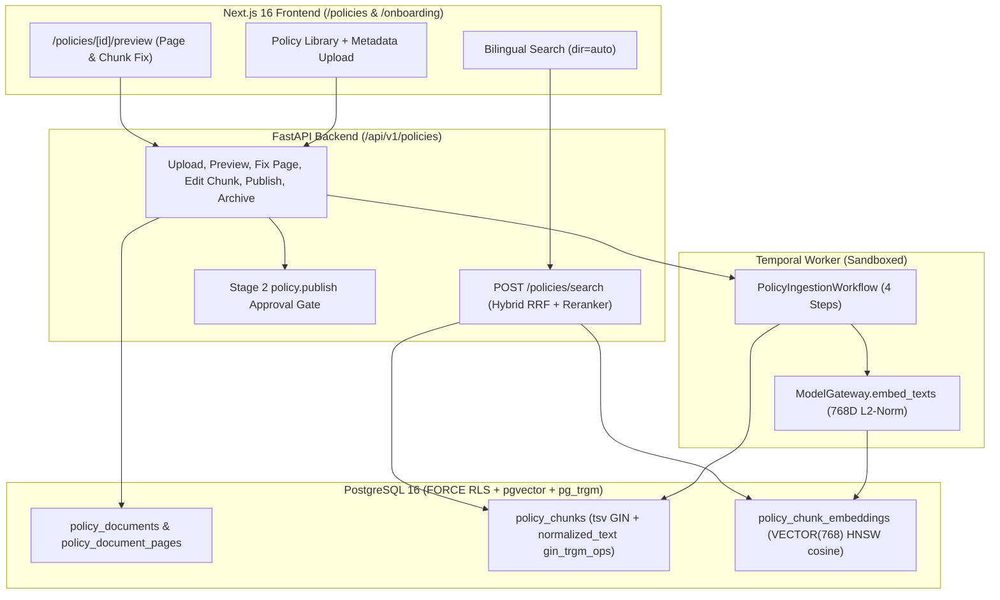

# Stage 5: Policy Ingestion & Bilingual Search (RAG Foundation) — Verification & Exit Gate Report

**Date:** 2026-11-22  
**Platform Version:** Agentic HR Core — Stage 5 (Policy Brain RAG Foundation)  
**Target Tag:** `v0.5-stage5-rag-verified`  
**Execution Environment:** Windows / Docker PostgreSQL 16 + `pgvector`, Redis, Temporal  
**Active Integration Mode:** `USE_FAKE_INTEGRATIONS=true` (with live `gemini-embedding-001` & `bge-m3` private routing parity)  
**Audit Status:** **STAGE 5 EXIT GATE READY**

---

## 1. Executive Summary & Architectural Guarantees

Stage 5 (**Policy Ingestion & Bilingual Search**) delivers the complete multi-tenant, bilingual (English & Urdu) RAG foundation for Agentic HR Core while strictly keeping Stage 5 scoped to **retrieval only** (deferring `/ask` LLM synthesis & grounding evals to Stage 7).

### Core Guarantees Across Prompts 1–7:
1. **Schema, Dual Lifecycle & Forced RLS (`0016_stage5_policy_ingestion_and_search.py`, ADR 008)**:
   - Upgraded `policy_documents` with versioning (`version`, `doc_type`, `visibility`, `lifecycle_status`, `effective_date`, `source`, `supersedes_document_id`, `approval_id`, `progress_pct`, `progress_stage`, `low_confidence_pages`, `has_prompt_injection_warning`, `archived_at`).
   - Added 3 forced-RLS tables (`policy_document_pages`, `policy_chunks`, `policy_chunk_embeddings`) with `pg_trgm`, HNSW cosine index (`m=16, ef_construction=64` on `VECTOR(768)`), GIN `'simple'` FTS index on `tsv`, and GIN `gin_trgm_ops` index on `normalized_text`.
   - Enforced strict dual-lifecycle invariants (`ingestion_status`: `queued -> processing -> indexed | needs_review | failed`; `lifecycle_status`: `draft -> review -> active -> superseded | archived`).
2. **Bilingual Normalizer, Permissive Parser & Clause-Aware Chunker**:
   - Shared `normalize_for_search()` & `normalize_bilingual_text()` (NFKC, zero-width stripping, Urdu Alef/Yeh/Teh-Marbuta canonicalization, Arabic-Indic -> ASCII digit folding, script detection, and prompt-injection signal scanning).
   - Permissive MIT/Apache parser (`pdfplumber` with `find_tables()` bbox exclusion, `python-docx` with reading-order tables & explicit page breaks, UTF-8 `.txt`), repeated header/footer stripping, and deterministic page quality scoring (`needs_ocr` < `0.60`).
   - Clause-aware chunker targeting 300–600 tokens with ~50-token sibling overlap and zero mid-clause/mid-table-row cuts.
3. **768D L2-Normalized Embeddings & Sandboxed Temporal Ingestion**:
   - `ModelGateway.embed_texts` (`gemini-embedding-001`, 768D mandatory L2 normalization, `RETRIEVAL_DOCUMENT` / `RETRIEVAL_QUERY`, fail-closed `"private"` route).
   - Idempotent 4-step `PolicyIngestionService` with chunk diff-preservation and tenant-wide `(content_hash, model, dim)` embedding reuse, orchestrated by sandboxed `PolicyIngestionWorkflow`.
4. **Policy Lifecycle REST APIs & Stage 2 Approval Governance**:
   - Full CRUD/Preview/Fix/Publish/Re-ingest/Archive endpoints under `/api/v1/policies` with streaming 10MB cutoff, magic-byte validation, and `RateLimiter`.
   - Stage 2 `policy.publish` approval handler atomically transitions `review -> active`, supersedes prior active versions, and returns rejected/returned drafts to `draft`.
5. **Hybrid Bilingual Retrieval Engine (`POST /api/v1/policies/search`)**:
   - SQL security/lifecycle/visibility pre-filtering BEFORE ranking -> `SET LOCAL hnsw.ef_search = 100` HNSW cosine + stopword-filtered `'simple'` FTS (with OR-fallback) + `pg_trgm` `word_similarity`/`similarity` -> Weighted RRF (`k=60`, `0.55` vector / `0.25` FTS / `0.20` trigram) -> `DeterministicPolicyReranker` -> canonical Stage 7 `PolicyCitation` & focused snippets.
6. **Next.js 16 Policy Workspace**:
   - 3-tab `/policies` workspace (**Policy Library**, **Bilingual Search** with `dir="auto"` & injection warnings, **OCR & Review Queue**), `/policies/[id]/preview` inline page/chunk repair + gated publish CTA, and Onboarding Step 2 live ingestion status.

---

## 2. Architecture Overview



---

## 3. Synthetic Policy Corpus & 18-Question Gold Set (`tests/fixtures/`)

| # | Policy Title | File | Visibility | Language | Stage 5 Behavior Verified |
| :--- | :--- | :--- | :--- | :--- | :--- |
| **1** | Leave & Time-Off Policy (**v1**) | `leave_policy_v1.docx` | `all` | `en` | Uploaded, published, then **superseded** by v2 (0 v1 chunks in search) |
| **2** | Leave & Time-Off Policy (**v2**) | `leave_policy_v2.docx` | `all` | `en` | Active edition (20 annual, 10 sick, 10 casual, 90 maternity, 5 bereavement) |
| **3** | Attendance & Working Hours Policy | `attendance_policy.docx` | `all` | `en` | 9 AM–6 PM PKT, 15-min grace, 3 lates = 0.5 day, native DOCX shift/OT table |
| **4** | Code of Conduct & Workplace Ethics | `code_of_conduct.pdf` | `all` | `en` | Embedded prompt-injection text (`has_injection_flag=True`) safely isolated |
| **5** | IT & Acceptable Usage Policy | `it_usage_policy_partly_scanned.pdf` | `all` | `en` | Clean Page 1 + scanned Page 2 (`needs_ocr` -> repaired via `/pages/2/fix`) |
| **6** | Benefits & Remote Work Policy | `benefits_and_remote_work_bilingual.docx` | `all` | `mixed` | Genuine Urdu script sections (WFH, internet & medical allowances) + English stipend |
| **7** | Compensation & Salary Bands Policy | `hr_salary_bands.docx` | `hr_only` | `en` | L1–L6 PKR salary bands & bonus multipliers restricted strictly to Owner / HR Head |

### 18-Question Gold Set & Exit Gate Matrix (`test_stage5_rag_evaluation.py`)

| Exit Gate | Target Threshold | Scope |
| :--- | :--- | :--- |
| **Overall Recall@5** | `>= 90%` (`>= 17/18`) | 14 same-language (`en`/`ur`) + 4 cross-language (`ur -> en` & `en -> ur`) questions |
| **Cross-Language Recall@5** | `>= 90%` (`4/4`) | `Q15`–`Q16` (Urdu -> English Leave/Attendance) & `Q17`–`Q18` (English -> Urdu WFH/Internet) |
| **Visibility Isolation** | `100%` (`0` leaks) | `employee` and plain `manager` (`is_hr_head=false`) receive `0` `hr_only` chunks |
| **Superseded Version Exclusion** | `100%` (`0` leaks) | Leave Policy `v1` returns `0` chunks across all roles after `v2` activation |
| **Prompt-Injection Defense** | `100%` | Injection marker flagged (`has_injection_flag=True`); zero restricted leakage |
| **Cross-Tenant RLS Isolation** | `100%` (`0` leaks) | Acme user searching exact Globex policy phrases receives `0` Globex chunks |

---

## 4. Verification Commands

```powershell
# Backend Lint & Stage 5 Suite
uv run ruff check apps/api ; uv run ruff format --check apps/api
uv run --package agentic-hr-api pytest apps/api/tests/test_stage5_rag_evaluation.py -v -s
uv run --package agentic-hr-api pytest apps/api/tests -q

# Frontend Typecheck, Lint, Unit & Playwright E2E
pnpm --filter @agentic-hr/contracts typecheck
pnpm --filter @agentic-hr/web typecheck
pnpm --filter @agentic-hr/web lint
pnpm --filter @agentic-hr/web test
pnpm --filter @agentic-hr/web exec playwright test --reporter=list
pnpm format:check
```
