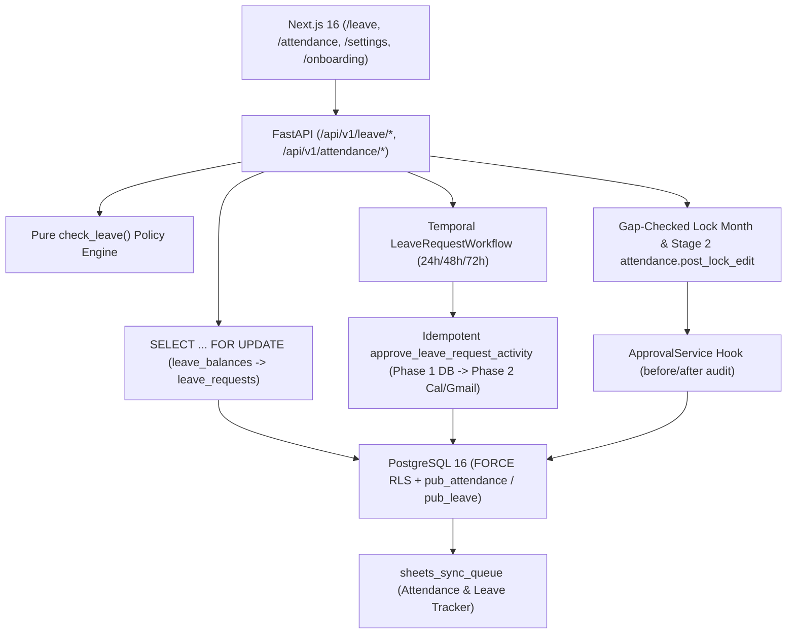

# Stage 6: Leave and Attendance — Verification & Exit Gate Report

**Date:** 2026-11-22  
**Platform Version:** Agentic HR Core — Stage 6 (Leave and Attendance)  
**Target Tag:** `v0.6-stage6-leave-attendance-verified`  
**Execution Environment:** Windows / Docker PostgreSQL 16 + `pgvector`, Redis, Temporal  
**Active Integration Mode:** `USE_FAKE_INTEGRATIONS=true`  
**Audit Status:** **STAGE 6 EXIT GATE READY**

---

## 1. Executive Summary & Architectural Guarantees

Stage 6 (**Leave and Attendance**) delivers deterministic Pakistani SME leave accounting, bilingual AI intake, durable Temporal approval orchestration, attendance tracking, and payroll-grade month-lock governance in compliance with **ADR 002** (Forced RLS), **ADR 005** (Postgres authoritative, Google Sheets synced view), and **ADR 009** (Leave & Attendance Architecture).

### Core Guarantees Across Prompts 1–7:
1. **Schema, Double-Entry `leave_ledger`, Secure Views & Forced RLS (`0017_stage6_leave_and_attendance.py`, ADR-009)**:
   - Added 8 Forced-RLS tenant-scoped tables: `leave_types`, `holidays`, `work_week`, `leave_balances`, `leave_ledger`, `leave_requests`, `attendance`, and `attendance_month_locks`.
   - Enforced runtime immutability on `public.leave_ledger` (`SELECT, INSERT` only for `agentic_hr_app`; `UPDATE`/`TRUNCATE`/runtime `DELETE` blocked by triggers while preserving migrator cascade compatibility).
   - Created `public.pub_attendance` and `public.pub_leave` read views with `security_invoker = true` and `security_barrier = true`.
   - Automatic `leave_balances` & `leave_ledger` initialization (`upfront` vs `monthly` `accrual_mode`) wired into `employee_service.py`, `employee_import_service.py`, and Onboarding Step 3.
2. **Pure Policy Check Engine & Scheduled Accrual / Carry-Forward**:
   - `leave_policy_engine.check_leave(...)` evaluates working days (excluding tenant weekends and non-optional holidays), half-day rules, balance sufficiency, overlap, probation restriction, consecutive limit, minimum notice, document threshold (`working_days > requires_document_after_days`), and team coverage (`max_team_absent_pct`, `min_team_present`) deterministically.
   - `LeaveAccrualWorkflow` executes idempotent monthly accrual and year-end carry-forward schedules via Temporal.
3. **Bilingual Intake Agent, `SELECT ... FOR UPDATE` Concurrency & Crash-Safe Temporal Approval**:
   - `parse_leave_intake` extracts English, Urdu, and Roman-Urdu leave requests via `ModelGateway` using `<untrusted_*>` tags and produces a code-verified Confirm Card.
   - `LeaveService.submit_leave_request` acquires `SELECT ... FOR UPDATE` on `leave_balances` before overlap/policy checks, preventing concurrent double-spends.
   - `approve_leave_request_activity` commits PostgreSQL state (`leave_balances`, `leave_ledger`, `attendance`, `leave_requests`, `outbox_events`, `sheets_sync_queue`) in Phase 1 before executing external Calendar/Gmail calls in Phase 2.
4. **Attendance Management, Month-Lock Governance & Google Sheets Sync**:
   - Self check-in/out (`check_in_enabled` toggle, `Asia/Karachi` PKT dates), Manager Daily Grid, Two-Phase `.xlsx` Attendance Import, Automated Month Auto-Fill (`leave_request_id` linkage), Gap-Checked Month Lock (`409 ATTENDANCE_GAPS_EXIST` refusal when gaps exist), and Stage 2 `attendance.post_lock_edit` approval hook with `before`/`after` audit diffs.
   - Idempotent `SheetsSyncService.enqueue_leave_tracker_sync` (`Leave Tracker`) and `enqueue_attendance_sync` (`Attendance`), plus deterministic 3-month seed (`seed_three_months_attendance`).
5. **Next.js 16 `/leave`, `/attendance`, `/settings` & Onboarding Step 3**:
   - Complete 5-tab `/leave` workspace (Balance Cards, AI Intake + Plain Form, My Requests, Manager Inbox, Team Calendar, HR Overview), `/attendance` workspace (Self Check-In Card, Manager Daily Grid, Excel Import, Month Review & Lock + Post-Lock Edit Modal), `/settings` Leave & Attendance Rules tab, and Onboarding Step 3 live wiring.

---

## 2. Architecture Flow



---

## 3. Master 16-Case Leave & Exit Gate Matrix (`test_stage6_exit_verification.py`)

| # | Exit Gate Case | Expected Behavior |
| :--- | :--- | :--- |
| **1** | Normal annual leave | `OK` -> approved -> `ON_LEAVE` + `deduct` ledger + `leave.approved` outbox |
| **2** | Insufficient balance | `BLOCKED` (`409 INSUFFICIENT_BALANCE`) |
| **3** | Overlapping leave | `BLOCKED` (`409 OVERLAPPING_LEAVE`) |
| **4** | Half day | `0.50` working days deducted cleanly + `HALF_DAY` attendance |
| **5** | Range across public holiday | Aug 14 Independence Day excluded from `working_days` & `ON_LEAVE` rows |
| **6** | Weekend-only range | `BLOCKED` (`409 ZERO_WORKING_DAYS`) |
| **7** | During probation | `VIOLATION` (`PROBATION_RESTRICTION`) -> Stage 2 `leave.exception` |
| **8** | Over consecutive limit | `VIOLATION` (`CONSECUTIVE_LIMIT_EXCEEDED`) -> Stage 2 `leave.exception` |
| **9** | Short notice | `VIOLATION` (`INSUFFICIENT_NOTICE`) -> Stage 2 `leave.exception` |
| **10** | Sick leave needing document | `BLOCKED` (`409 DOCUMENT_REQUIRED`) without doc; `201 OK` with `document_id` |
| **11** | Team coverage exceeded | `VIOLATION` (`TEAM_COVERAGE_EXCEEDED`) -> Stage 2 `leave.exception` |
| **12** | Cancel after approval | Restores balance (`reversal`), deletes linked `ON_LEAVE`, emits `leave.cancelled` |
| **13** | Two simultaneous submissions | `asyncio.gather` on tight balance -> `1x 201`, `1x 409`, 0 negative balance |
| **14** | Manager rejects | Releases `reserved_days` via `release` ledger row |
| **15** | Manager silent (Temporal) | 24h reminder audit, 48h backup escalation (`owner`), 72h expiry release |
| **16** | HR exception reject & approve | Reject releases reservation; Manager + HR approve completes deduction |
| **Gate** | Mid-approval worker crash | Crash after Phase 1 commit + retry -> `1` outbox, `1` deduct, `1` calendar |
| **Gate** | 3-Month Seed & Secure Views | 3 months in `pub_attendance` + `pub_leave` with `0` cross-tenant leaks |

---

## 4. Verification & Tagging Commands

```powershell
# 1. Backend Lint, Format & Master Stage 6 Exit Suite
uv run --no-sync ruff check apps/api ; uv run --no-sync ruff format --check apps/api
uv run --package agentic-hr-api pytest apps/api/tests/test_stage6_exit_verification.py -v -s
uv run --package agentic-hr-api pytest apps/api/tests -q

# 2. Frontend Typecheck, Lint, Unit Tests, Build & Playwright E2E
pnpm --filter @agentic-hr/contracts typecheck
pnpm --filter @agentic-hr/ui typecheck
pnpm --filter @agentic-hr/web typecheck
pnpm --filter @agentic-hr/web lint
pnpm --filter @agentic-hr/web test
pnpm --filter @agentic-hr/web build
pnpm --filter @agentic-hr/web exec playwright test --reporter=list
pnpm format:check

# 3. Git Tag Once All Gates Pass
git tag -a v0.6-stage6-leave-attendance-verified -m "Stage 6 Leave and Attendance Verified"
```
